# Trading Trend Detection Data Flow

The current pipeline separates validated events before event-time windowing.
Analytical events enter the five-minute tumbling-window path, while housekeeping
events are retained on their own symbol-keyed Kafka output. Invalid records and
events that arrive after the lateness bound leave through separate paths.

The current implementation calculates EMA38 and EMA100 for every symbol after
each completed window, detects Query 2 crossovers, and filters user-facing
window and advisory outputs by optional subscriptions. Smart visualization is
not implemented.

```mermaid
flowchart LR
    A[Daily trading CSV files] --> B[Replay producer<br/>chunked reader]
    B -->|key = exchange-qualified symbol| C[(Kafka<br/>trading-events)]
    C --> D[Flink Kafka source]

    subgraph PREP[Normalize and validate]
        D --> E[normalization.py<br/>parse envelope and event time]
        E --> F[validation.py<br/>validate identity and prices]
        F --> G{Valid event?}
    end

    G -->|no| DLQ[(Dead-letter topic)]
    G -->|yes| K[Key every valid event<br/>by exchange-qualified symbol]
    K --> N[(Normalized-events topic)]
    K -->|trade or quote| X[Analytical event stream]
    K -->|housekeeping| H[(Housekeeping topic<br/>still symbol-keyed)]

    subgraph WINDOW[Analytical event-time path]
        X --> W[Assign exchange-local timestamps<br/>DST-aware watermark]
        W --> T[windowing.py<br/>five-minute tumbling windows<br/>local midnight aligned]
        T -->|watermark passes window end| R[Build per-symbol window result<br/>latest trade / Close and counts]
        T -. late after allowed lateness .-> LATE[(Late-events topic)]
    end

    R --> EKEY[Key completed windows<br/>by symbol]
    EKEY --> EMA[ema.py<br/>calculate EMA38 and EMA100<br/>per-symbol keyed state]
    EMA --> ALL[(All-symbol EMA results)]
    EMA --> Q2[crossover.py<br/>Query 2 buy/sell detection]
    Q2 --> SUB[Subscription filter<br/>after state updates]
    SUB --> WR[(Subscribed window results)]
    SUB --> ADV[(Buy/sell advisories)]

    E --> OBS[Metrics and structured logs<br/>throughput, latency, rejects, late events]
    W --> OBS
    T --> OBS
```

## Windowing separation

- **Analytical stream:** `trade` and `quote` events receive event-time
  timestamps and watermarks, are keyed by symbol, and are processed in
  non-overlapping five-minute tumbling windows.
- **Housekeeping stream:** housekeeping events bypass the analytical windows
  and are written to the housekeeping Kafka topic for retention or monitoring.
- **Late-event stream:** analytical events arriving after the configured
  bounded-lateness period are emitted to the late-events topic instead of
  changing a completed window.
- **Invalid-event stream:** records rejected during normalization or validation
  are emitted to the dead-letter topic with a reason code.

## Midnight alignment

The assignment requires the first window to begin at midnight in the dataset's
CEST trading-time convention. The dataset dates in this project are in
November, when the European exchange time zones use UTC+01:00 (CET), not
UTC+02:00 (CEST). Therefore, a hard-coded Flink offset such as `-2 hours` is
not a reliable implementation of the requirement. The production windowing
path should convert each event to the configured exchange/trading timezone and
derive a calendar-day midnight boundary, or use a date-aware timestamp shift
before applying the five-minute tumbling window. This must also handle daylight
saving transitions rather than assuming one permanent offset.

The worker now converts each event to an exchange-local, DST-aware wall-clock
timestamp before applying a zero-offset five-minute tumbling window. The
original event timestamp remains unchanged in the window result. This makes
midnight alignment use UTC+01:00 in winter and UTC+02:00 in summer without a
hard-coded seasonal offset.
