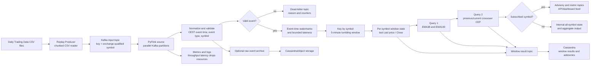

# Trading Trend Detection System Design

## 1. Scope and requirements

This document describes the architecture for the CS-E4780 course project,
Detecting Trading Trends in Financial Tick Data. It is a design document only;
it does not implement the proposed system.

The system processes the one-week Trading Data dataset: 289 million events for
5,504 equities and indices on the Paris (FR), Amsterdam (NL), and
Frankfurt/Xetra (ETR) exchanges. The source is one CSV file per day. Event
types are implicit: the non-NULL payload attribute identifies whether an event
is an ask, bid, price/trade, or housekeeping update. Events for the same symbol
are not guaranteed to be globally ordered across exchanges.

### 1.1 Core requirements

The following requirements are mandatory for the project implementation and
should be treated as acceptance criteria:

1. Ingest the real tick data and preserve its event-time semantics.
2. Identify an instrument by the exchange-qualified symbol (`ID.[Exchange]`)
   and retain its security type (`E` equity or `I` index).
3. Group all processing by symbol. Maintain calculations for every symbol,
   while emitting user-facing updates only for a configured subscribed subset.
4. Use five-minute, non-overlapping tumbling windows. Window `w0` starts at
   midnight CEST, and window `wi` is evaluated when `wi+1` starts.
5. For every symbol and completed window, use the last observed `Last` price as
   `Close[s,w]` and calculate both EMA38 and EMA100. The first EMA for a symbol
   uses the specified initial value zero for the preceding EMA.
6. Detect a bullish crossover when EMA38 moves from at-or-below EMA100 in the
   preceding completed window to above EMA100 in the current window. Emit a
   buy advisory immediately after the crossover is detected.
7. Detect a bearish crossover when EMA38 moves from at-or-above EMA100 in the
   preceding completed window to below EMA100 in the current window. Emit a
   sell advisory immediately after the crossover is detected.
8. Handle out-of-order input with event-time timestamps and a documented
   bounded-lateness policy. Records that cannot be assigned reliably must be
   counted and observable rather than silently discarded.
9. Produce reproducible outputs that can be checked for correctness, and
   provide throughput, latency, failure, and resource measurements for the
   report.

### 1.2 Optional and perfection features

These features are not needed to define the basic query semantics, but they
support exceptional scores in creative exploration, scalability, and the
report:

- A smart dashboard showing price/EMA lines, crossover markers, symbol and
  exchange filters, and advisory status for subscribed symbols.
- Kafka partitioning by exchange-qualified symbol and a configurable Flink
  parallelism so all three exchanges and the long-tail symbol distribution can
  be evaluated at scale.
- Checkpointing, exactly-once or idempotent output behavior, and restart
  recovery with documented trade-offs.
- A dead-letter topic and replayable rejected-event store with reason codes.
- A metadata side input or cache for security type, currency, ISIN, and exchange
  labels.
- Late-event correction or retraction handling, rather than only a fixed
  allowed-lateness policy.
- Historical backfill and live replay modes using the same normalized event
  contract.
- Comparative experiments for different parallelism, batch size, watermark,
  and persistence settings, including CPU and memory utilization.
- Alert delivery through a separate advisory topic, WebSocket/API, or another
  user-facing channel in addition to durable storage.

Optional features must not change the mandated EMA and crossover definitions.

## 2. Proposed architecture

The existing repository already provides the right high-level technology
shape: a CSV producer, Kafka, a PyFlink worker, Cassandra persistence, and
structured logging. The project implementation should adapt that skeleton to a
symbol-keyed financial event pipeline.



### 2.1 Ingestion and replay

The producer reads each daily CSV incrementally, using a bounded chunk size so
the full week is never loaded into memory. It should publish an envelope with
the original row, source file/day, a stable event identifier, the event-time
fields from the dataset, and the normalized symbol key. Kafka message keys must
be the exchange-qualified symbol so events for a symbol remain ordered within a
partition. The producer needs a replay mode that can preserve source order and
an optional rate/burst mode for load experiments.

The producer must not replace the dataset's trading timestamp with the wall
clock. Wall-clock production time can be retained separately for ingestion and
end-to-end latency measurements. Input files and their row counts should be
recorded so the evaluation can prove that the complete week was attempted.

### 2.2 Normalization and event classification

The normalization stage parses the required fields (`ID.[Exchange]`, `SecType`,
`Last`, `Trading time`, and `Trading date`) and converts the CEST trading date
and time to a timezone-aware event timestamp. It validates the exchange code,
security type, symbol, and numeric price fields. The original payload should be
retained for traceability, while the stream contract should contain at least:

```text
event_id, symbol, exchange, security_type, trading_date,
event_time, last_price, event_type, source_file, produced_at
```

`event_type` is derived from the non-NULL attributes according to the dataset
semantics. Price events with a usable `Last` value feed the EMA query. Ask, bid,
and housekeeping events may be retained and counted but do not update `Close`
unless the project explicitly documents an additional derived metric. Missing,
malformed, or unsupported records go to a dead-letter path with a reason code.

### 2.3 Time and window semantics

The stream uses event-time processing, not processing-time windows. Timestamps
are interpreted in CEST for the dataset and normalized internally to UTC. Window
bounds are aligned to midnight CEST and have a duration of exactly 300 seconds:

```text
window_start = midnight_CEST(date) + floor(seconds_since_midnight / 300) * 300s
window_end   = window_start + 300s
```

Flink watermarks advance after a configured bounded out-of-orderness interval.
The initial value should be selected from measured disorder in the dataset and
reported as an experiment parameter. A window is emitted when the watermark
passes its end, which implements the requirement that `wi` is evaluated as the
next window starts. The design should document whether a late event is dropped,
sent to a correction stream, or causes an idempotent update to an already stored
window.

### 2.4 Query 1: EMA state

The keyed window operator stores, per symbol:

- the latest valid `Last` event in the current window;
- `Close[s,w]`, the last price in the completed window;
- the previous EMA38 and EMA100;
- the previous window's EMA pair and window identity for crossover detection;
- counters for valid prices, ignored event types, late events, and malformed
  records.

For each completed window and smoothing period `j` in `{38, 100}`, calculate

```text
alpha_j = 2 / (j + 1)
EMA[s,w,j] = alpha_j * Close[s,w] + (1 - alpha_j) * EMA[s,w-1,j]
EMA[s,w0,j] = alpha_j * Close[s,w0]
```

The first-window rule is equivalent to the assignment's previous EMA value of
zero. Symbols with no valid `Last` price in a window need an explicit policy:
carry forward the last valid close only if this is justified and reported, or
emit a window status without updating the EMA. The chosen policy must be
consistent in the reference implementation and validation oracle.

The query result should include symbol, exchange, security type, window bounds,
close, EMA38, EMA100, price-event count, lateness information, and an
`all_symbol`/`subscribed` visibility indicator.

### 2.5 Query 2: crossover advisories

The crossover detector consumes the ordered EMA pair for each symbol. For a
current window `w` and previous window `w-1`:

```text
buy  = EMA38[s,w-1] <= EMA100[s,w-1]
       and EMA38[s,w] > EMA100[s,w]

sell = EMA38[s,w-1] >= EMA100[s,w-1]
       and EMA38[s,w] < EMA100[s,w]
```

When either predicate becomes true, emit one advisory containing a unique
advisory id, symbol, window, event time, action (`BUY` or `SELL`), both current
and previous EMA pairs, and the close. Advisory output should be idempotent on
the symbol/window/action key so retries do not create duplicate signals. The
detector must run for every symbol; subscription filtering happens after state
and query computation, not before it.

### 2.6 Subscription and delivery

Subscription configuration maps a user or dashboard session to a set of
exchange-qualified symbols. The calculation path is global, while the delivery
path filters window updates and advisories to subscribed symbols. This directly
implements the requirement that all symbols are continuously calculated but
only a subset produces user-facing updates.

Use separate logical outputs for:

- all-symbol window metrics for audit and evaluation;
- subscribed window results;
- buy/sell advisories;
- rejected events and operational metrics.

Kafka is suitable for fan-out and replay. Cassandra is suitable for keyed
historical queries, but its tables must be designed around the dashboard access
patterns rather than around arbitrary scans.

## 3. Storage and component design

### 3.1 Kafka topics

The minimum topic set is:

| Topic | Key | Purpose |
|---|---|---|
| `trading.events` | symbol | Normalized input events |
| `trading.window-results` | symbol/window | Query 1 results for all symbols |
| `trading.advisories` | symbol/window/action | Query 2 buy/sell events |
| `trading.dead-letter` | event id | Invalid or unrecoverable input |
| `trading.metrics` | component | Throughput, latency, and loss metrics |

The input topic should have multiple partitions for scalability experiments.
The partition count, producer acknowledgements, retention, and consumer group
must be recorded in the report.

### 3.2 Cassandra tables

Recommended logical tables are:

- `window_results_by_symbol`: partition by symbol and bucket by trading date;
  cluster by window start; store close, EMA pair, counts, and processing times.
- `advisories_by_symbol`: partition by symbol and bucket by date; cluster by
  advisory window; store action and the EMA evidence.
- `subscriptions_by_user`: store subscribed symbol ids and update time.
- `raw_events_by_symbol` (optional): retain normalized events for audit and
  debugging, with a bounded retention period.
- `dead_letters` (optional but recommended): store event id, source, reason,
  raw payload reference, and ingestion time.

Use prepared statements, asynchronous/batched writes where safe, and idempotent
keys for window results and advisories. The current single-keyspace,
single-replica local setup is appropriate for development, but its limitations
must be stated when discussing production scalability.

### 3.3 Dashboard and API (optional)

A small read API can expose the latest EMA pair, historical windows, and recent
advisories for subscribed symbols. A dashboard should make the result directly
interpretable: show the close and two EMA lines over time, mark BUY and SELL
crossovers, display exchange/security-type context, and indicate stale or late
data. It should query the read model rather than the stream processor directly.

## 4. Reuse assessment of the existing code

### 4.1 Reusable with small adaptation

| Existing module | Reuse value | Required adaptation |
|---|---|---|
| `producer.py` | Chunked CSV reading, Kafka publishing, rate limiting, delivery logging, topic creation | Read Trading Data columns; preserve CEST trading timestamps; derive exchange-qualified symbol; use symbol as Kafka key; remove Airbnb tenant/field assumptions |
| `streamworker_flink.py` | PyFlink Kafka source, timestamp assignment, watermarks, tumbling event-time windows, process function, sink lifecycle | Replace generic average aggregation with per-symbol Close/EMA state and crossover detection; configure parallelism and symbol partitioning |
| `streamworker.py` | CLI orchestration, connector-jar setup, topic management, metrics snapshots, result emission | Replace `TENANT_RULES` and tenant/group keys with project configuration; expose lateness, parallelism, and subscription settings |
| `cassandra_insert.py` | Cassandra connection/bootstrap lifecycle and insert abstraction | Add symbol-keyed EMA window and advisory schemas; include EMA evidence and idempotent advisory keys; avoid a tenant-only partition for the full dataset |
| `alerting.py` | JSON publication, at-least-once retry helper, monitoring-event pattern | Publish advisory and metric payloads; make retries safe through deterministic output keys |
| `utils.py` | Timestamp parsing, structured logs, metrics logger, safe JSON serialization | Extend CEST date/time parsing and add counters for event types, late data, invalid records, and advisories |

### 4.2 Logic that must not be reused unchanged

The current worker is an Airbnb demonstration pipeline. Its `TENANT_RULES`
configuration, neighbourhood grouping, five-second window, `price` average, and
allowed-lateness assumptions do not satisfy the trading assignment. The current
producer also sets `event_time` to `produced_at`, which would destroy the
required trading-time window semantics. The current result table is keyed by
tenant and group rather than exchange-qualified symbol and lacks EMA/advisory
columns. These are domain mismatches, not cosmetic changes.

The existing pure-Python `aggregate_windowed_results` function is useful as a
test oracle pattern, but it should not be the production path for 289 million
events because it groups an in-memory list and computes an average. A bounded,
keyed Flink state implementation is the appropriate production design.

## 5. Reliability, correctness, and operations

### 5.1 Failure and delivery semantics

Use Kafka consumer groups and Flink checkpoints for recoverability. Decide and
measure whether the first implementation uses at-least-once processing with
idempotent Cassandra keys or exactly-once sinks. A retry must never produce a
second advisory for the same symbol/window/action. Persist checkpoint and
consumer configuration in the run instructions used for the evaluation.

### 5.2 Observability

At minimum, record input rows, valid price events, events by type and exchange,
late events, rejected events by reason, completed windows, advisories by action,
Kafka lag, throughput, watermark delay, processing latency, persistence
latency, CPU, memory, and failures. Every result should carry source/window
identity sufficient to trace it back to the input day and symbol.

### 5.3 Correctness oracle

Build a small deterministic reference calculation over selected symbols and
days. It should independently parse the CSV, align five-minute CEST windows,
select the last `Last` value, calculate EMA38/EMA100, and apply the crossover
predicates. Compare the stream output with the oracle on close, EMA values,
window identity, and advisory action. Include boundary cases: midnight,
exactly-on-boundary timestamps, missing prices, equal EMAs, out-of-order events,
and the first window's zero initialization.

## 6. Evaluation plan for the report

The report should follow the required ACM 4-5 page structure and include these
measurements:

1. **Correctness:** reference-oracle agreement for both queries, counts of
   false/missed advisories, and handling of all required event types.
2. **Throughput and latency:** input events per second, completed windows per
   second, end-to-end latency, watermark delay, and persistence latency.
3. **Scalability:** one versus multiple Kafka partitions, all three exchanges,
   increased Flink parallelism, and workloads that preserve the dataset's
   long-tail symbol distribution.
4. **Resource use:** CPU, memory, disk, Kafka lag, Cassandra write pressure,
   and any GPU result. GPU use is not expected for this stateful streaming
   workload; report that fact rather than introducing a GPU solely for scoring.
5. **Robustness:** restart recovery, duplicate delivery, malformed rows, late
   events, and Cassandra/Kafka availability.
6. **Visualization:** for the optional feature, measure whether a user can
   identify a crossover from the displayed symbol, window, EMA values, and
   action without inspecting raw logs.

## 7. Implementation sequence

1. Define and unit-test the normalized financial event contract and CEST parser.
2. Adapt the producer and verify row counts, timestamps, symbols, and Kafka
   keys on a small input slice.
3. Implement the keyed five-minute event-time window and validate `Close`.
4. Add EMA38/EMA100 state and compare against the reference oracle.
5. Add previous/current crossover detection and idempotent advisories.
6. Add Cassandra schemas and output topics, then test restart and duplicate
   behavior.
7. Add subscription filtering after computation.
8. Run correctness, throughput, scale, and resource experiments over increasing
   slices up to the full week.
9. Add the optional dashboard only after the streaming outputs are correct and
   measurable.

## 8. Design decisions and open parameters

The following values should be configuration, not hard-coded assumptions:

- Kafka input partition count and Flink operator parallelism.
- Bounded out-of-orderness and allowed lateness.
- Policy for a window with no valid `Last` value.
- Retention and sampling policy for raw events.
- At-least-once/idempotent versus exactly-once persistence mode.
- Subscription source and update mechanism.
- Whether late-window corrections are emitted as updates or retained for audit.

The mandatory semantics remain fixed while these operational parameters are
varied and reported as part of the system evaluation.